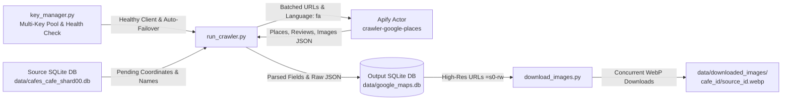

# Google Maps Cafe Data & Photo Scraper

A robust, fault-tolerant, and high-throughput data extraction pipeline designed to harvest complete raw metadata, rich reviews, and uncompressed, ultra-high-resolution photos of cafes and venues from Google Maps using Apify.

---

## Table of Contents
- [Key Features](#key-features)
- [Architecture & Workflow](#architecture--workflow)
- [Prerequisites & Installation](#prerequisites--installation)
- [Environment Configuration](#environment-configuration)
- [Usage Guide](#usage-guide)
  - [1. Scraping Data from Google Maps](#1-scraping-data-from-google-maps)
  - [2. Downloading High-Resolution Photos](#2-downloading-high-resolution-photos)
- [Technical Architecture](#technical-architecture)
  - [Geo-Targeted Coordinate Matching](#geo-targeted-coordinate-matching)
  - [Ultra High-Resolution WebP Media Pipeline (`=s0-rw`)](#ultra-high-resolution-webp-media-pipeline-s0-rw)
  - [Resumability & Fault Tolerance](#resumability--fault-tolerance)
  - [Zero Data Loss Storage](#zero-data-loss-storage)
- [Database Schema Reference](#database-schema-reference)
- [Directory Structure](#directory-structure)
- [Security & Best Practices](#security--best-practices)

---

## Key Features

- **Multi-Key Token Pool & Auto-Rotation:** Manages multiple Apify accounts simultaneously, monitoring remaining USD credits and monthly usage in real time. Transparently switches to the next healthy account whenever a key's quota or credit limit is exhausted.
- **Live Account Balance & Health Endpoint Inspection:** Built-in CLI and Python interface querying Apify's `/v2/users/me` and `/v2/users/me/limits` to display active balances, limits, and tiers.
- **Geo-Targeted Viewport Search:** Eliminates ambiguous match errors and cross-city collision by anchoring the Google Maps viewport radius to ~200-300m (`Zoom 17`) centered on exact geographic coordinates.
- **Zero Data Loss:** Preserves the entire unstructured JSON payload returned by Apify/Google in `raw_data` while simultaneously indexing structured columns (rating, reviews, phone, categories, address).
- **Camera-Original Resolution WebP Media Engine (`=s0-rw`):** Automatically detects Google server-side image scaling flags (`=w...-h...`) and transforms them into `=s0-rw`, pulling camera master files natively formatted as WebP (reducing storage and bandwidth by >50% with zero resolution loss).
- **Resumable & Fault-Tolerant:** Tracks crawler state directly within SQLite. In the event of network disruption or process termination, subsequent runs skip previously completed places and resume cleanly.
- **High-Throughput Parallel Downloader:** Multi-threaded asynchronous asset downloader with retry mechanisms and adaptive fallback handling.
- **Batched Execution:** Distributes search operations in batches to `compass/crawler-google-places` on Apify to optimize API memory allocation and run costs.
- **Deep Venue Profile Extraction:** Extracts neighborhoods (`neighborhood`), commercial complexes (`located_in`), floors (`floor`), digital menus, official owner introductions (`owner_description`), Google Plus Codes, Knowledge Graph IDs (`kgmid`), and 1-to-5 star rating distributions.
- **Optional Contacts & Social Media Enrichment:** Built-in support (`--scrape-contacts`, `--scrape-socials`) to automatically extract company emails, phone numbers, and Instagram/Facebook profiles directly from venue websites.
- **Rich Review Metadata & Context:** Captures direct review URLs, reviewer profiles, and detailed context parameters including order type (dine-in/takeout), meal category, price per person, noise levels, and localized translations.
- **Zero Hardcoding & Portability:** Fully configurable paths, batch sizes, retry parameters, and concurrency limits via standard `.env` variables and CLI arguments.

---

## Architecture & Workflow



---

## Prerequisites & Installation

### 1. Requirements
- Python 3.9 or higher
- An active [Apify Account](https://apify.com) with API access token

### 2. Environment Setup
Clone the repository and set up a virtual environment:

```bash
# Clone the repository
git clone https://github.com/osumy/apify_maps.git
cd apify_maps

# Create a virtual environment
python -m venv .venv

# Activate the virtual environment
# On Windows:
.venv\Scripts\activate
# On Linux / macOS:
source .venv/bin/activate

# Install required dependencies
pip install -r requirements.txt
```

---

## Environment Configuration

Copy the sample environment file `.env.example` to create your active `.env`:

```bash
cp .env.example .env
```

Open `.env` and provide your Apify API token along with any custom path overrides:

```env
# Apify API Tokens (Multi-Key Pool - JSON list or comma-separated)
APIFY_TOKENS='["apify_api_token1", "apify_api_token2"]'

# Single Token Fallback (Optional)
APIFY_TOKEN=apify_api_xxxxxxxxxxxxxxxxxxxx

# Source database containing input cafes with coordinates (table: cafes_cafe)
SOURCE_DB_PATH=data/cafes_cafe_shard00.db

# Output SQLite database file path
OUTPUT_DB_PATH=data/google_maps.db

# Output directory for downloaded images
IMAGES_DIR=data/downloaded_images

# Concurrency level for image downloads
MAX_IMAGE_WORKERS=25

# Crawler batch size per Apify run
BATCH_SIZE=50

# Maximum photos to request per place
MAX_IMAGES_PER_PLACE=50

# Maximum reviews to request per place
MAX_REVIEWS_PER_PLACE=15

# Viewport zoom level
ZOOM_LEVEL=17

# Optional contacts & social media enrichment (default: false)
SCRAPE_CONTACTS=false
SCRAPE_SOCIAL_MEDIA_PROFILES=false
```

---

## Usage Guide

### 1. Scraping Data from Google Maps

To run the full crawler over all pending cafes from the source database:
```bash
python run_crawler.py
```

To run a limited test run with custom batch size or contacts enrichment:
```bash
# Scrape the next 50 pending venues with contact & social profile enrichment:
python run_crawler.py 50 --scrape-contacts --scrape-socials

# Specify custom database and jsonl paths:
python run_crawler.py 50 --source-db "path/to/source.db" --output-db "data/output.db"
```

### 2. Retroactive Schema Migration & Backfill

If you have previously scraped raw JSONL files and want to backfill missing fields (neighborhoods, 5-star distributions, review contexts) into the relational database:
```bash
python migrate_schema_and_backfill.py
```

### 3. Downloading High-Resolution Photos

To download all scraped high-resolution photos for all successfully matched cafes:
```bash
python download_images.py
```

### 3. Inspecting Apify Account Balances & Key Health

The repository includes a dedicated CLI balance and pool manager (`key_manager.py`) that queries Apify's official `/v2/users/me` and `/v2/users/me/limits` endpoints:

To display an ASCII dashboard of all keys, user identities, monthly limits, current usage, and remaining USD:
```bash
python key_manager.py
```

Sample output:
```text
================================================================================================
                        APIFY MULTI-KEY POOL STATUS & BALANCES
================================================================================================
#   | Token                  | User / Email                 | Tier   | Limit   | Used    | Rem.    | Status
------------------------------------------------------------------------------------------------
1   | apify_api_AbCd1...9xYz01 | dev_primary (user1@example.) | FREE   | $10.00  | $6.95   | $3.05   | 🟢 ACTIVE
2   | apify_api_EfGh2...8wVu23 | backup_team (user2@example.) | FREE   | $5.00   | $0.00   | $5.00   | 🟢 ACTIVE
3   | apify_api_IjKl3...7tSr45 | Unknown                      | UNKNOWN | -       | -       | -       | 🔴 INVALID
4   | apify_api_MnOp4...6qPo67 | spare_pool (user3@example.c) | FREE   | $5.00   | $0.00   | $5.00   | 🟢 ACTIVE
------------------------------------------------------------------------------------------------
Summary: Total Keys: 4 | Active: 3 | Exhausted: 0 | Invalid: 1
Total Usable Balance: $13.05 USD
Current Working Key: apify_api_AbCd1...9xYz01 (User: dev_primary, Rem: $3.05)
================================================================================================
```

To export the pool status in JSON format:
```bash
python key_manager.py --json
```

To run unit tests verifying key failover, error detection, rotation, and matching logic:
```bash
python -m unittest discover tests
```

To download photos for a specific venue by its ID (e.g., cafe ID `32`):
```bash
python download_images.py 32
```

### 4. Running on Google Colab or Kaggle (with Google Drive Storage)

A ready-to-run Jupyter notebook [`google_maps_scraper.ipynb`](google_maps_scraper.ipynb) is included for cloud environments (Google Colab / Kaggle):

1. Open `google_maps_scraper.ipynb` in Google Colab or Kaggle.
2. Run the cells in sequence:
   - **Mount Drive:** Mounts `/content/drive` so all outputs persist directly on your Google Drive.
   - **Configure Paths:** Point `SOURCE_DB_PATH` to your Google Drive folder (e.g. `/content/drive/MyDrive/apify_maps_data/cafes_cafe_shard00.db`).
   - **Inspect Balances:** Runs live balance and key health checks across all your Apify accounts.
   - **Run Scraper:** Executes batched scraping with real-time `tqdm` progress and batch-by-batch commits.
   - **Download Photos:** Concurrently pulls camera-original WebP photos (`=s0-rw`) directly into Google Drive with periodic database updates.

```python
from run_crawler import run_scraper
from download_images import download_images

# Modular scraping with custom Drive paths
run_scraper(
    source_db_path="/content/drive/MyDrive/apify_maps_data/cafes_cafe_shard00.db",
    output_db_path="/content/drive/MyDrive/apify_maps_data/google_maps.db",
    raw_jsonl_path="/content/drive/MyDrive/apify_maps_data/google_maps_raw.jsonl",
    batch_size=50
)
```

Photos are organized hierarchically:
```text
downloaded_images/
├── 32/
│   ├── photo_1.jpg
│   ├── photo_2.jpg
│   └── photo_3.jpg
└── 100/
    ├── photo_1.jpg
    └── photo_2.jpg
```

---

## Technical Architecture

### Strict Multi-Factor Matching Engine (`cafe_matcher.py`)
> 📖 **Full Engineering Specification:** See [`docs/MATCHING_SPECIFICATION.md`](docs/MATCHING_SPECIFICATION.md) for complete mathematical formulas, phoneme mapping tables, multi-gate decision rules, and benchmark case studies.

To prevent catastrophic false positives (e.g. showing wrong photos, menus, or addresses from distant venues), the scraper uses a multi-tier matching engine:
1. **Top-5 Candidate Evaluation:** Apify extracts up to 5 places per search query (`MAX_PLACES_PER_SEARCH=5`), preventing ads or nearby shops from masking the true venue.
2. **Geographic Distance Decay & Hard Veto:** Distance is measured with the Haversine formula. Candidates $> 250\text{m}$ away are strictly **disqualified** (vetoed). Close matches ($\le 30\text{m}$) receive full score, decaying smoothly towards 200m.
3. **Cross-Lingual Phonetic Transliteration:** Maps Persian cafe names to Latin phonemes (e.g. *کافه رستوران عباس آقا* $\to$ *abbasagha* vs *Abbasagha Restaurant* $\to$ *abbasagha* = 0.95+ match), correctly matching English Google entries without false mismatches.
4. **Digital Identity Signals:** Direct phone matches (normalized 10-digit) and Instagram username matches provide high-confidence verification and relax distance buffer up to 350m.
5. **Strict Composite Threshold:** Venues must achieve a composite score $\ge 0.80$ (`MATCH_THRESHOLD=0.80`) to be accepted as `success`. Low-confidence results are rejected without saving wrong photos or reviews.
6. **Audit & Cleansing Tool:** Run `python audit_and_clean_db.py` to audit existing databases and flag or purge false matches.

### Ultra High-Resolution WebP Media Pipeline (`=s0-rw`)
Google Maps serves user-uploaded images via dynamic content delivery parameters (e.g., `=w1920-h1080-k-no`). The scraper parses image URLs and replaces any downsampling parameters with `=s0-rw`:
- `=s0-rw` instructs Google's FIFE edge servers to serve the uncompressed, full-dimension original master image natively encoded in **WebP format** (`image/webp`).
- Benchmarking confirms this reduces file sizes by **>50%** compared to standard JPEG with 100% pixel-level dimension preservation.
- If a rare server-side HTTP 400 error occurs on an unformatted asset, the downloader gracefully falls back to high-res `=w1600-h1200-rw`.

### Resumability & Fault Tolerance
Each crawler run initializes the target database and builds an index of previously evaluated `cafe_id` entries (including both successful matches and verified `not_found` records). Unmatched cafes are logged to prevent redundant API queries. Any interrupted session resumes exactly where it left off.

### Zero Data Loss Dual-Storage Architecture
The system decouples raw extraction from analytical querying:
1. **Raw Storage (`data/google_maps_raw.jsonl`):** Each raw JSON payload returned by Apify is preserved 100% intact as append-only JSON Lines. If Google changes or adds fields in the future, zero data is lost.
2. **Clean Relational DB (`data/google_maps.db`):** Highly normalized SQLite tables without redundant text dumps, indexed for fast querying, filtering, and joining.

---

## Database Schema Reference

The relational database (`data/google_maps.db`) consists of dedicated, indexed tables:

### 1. Table: `places` (Core Venue Profile)
| Column | Type | Description |
| :--- | :--- | :--- |
| `cafe_id` | `INTEGER PRIMARY KEY` | Source database cafe identifier |
| `place_id` | `TEXT UNIQUE` | Canonical Google Place ID (`ChIJ...`) |
| `cid` | `TEXT` | Google Maps customer ID |
| `title` | `TEXT` | Verified business name on Google Maps |
| `original_name` | `TEXT` | Source query name |
| `name_match_score` | `REAL` | Composite match confidence score (0.0 - 1.0) |
| `distance_meters` | `REAL` | Distance in meters between source and matched coordinates |
| `neighborhood` | `TEXT` | Neighborhood or urban district (e.g. نازی‌آباد, تجریش) |
| `located_in` | `TEXT` | Commercial complex or mall (e.g. مرکز خرید گالریا, بام‌لند) |
| `floor` | `TEXT` | Floor level inside building or complex |
| `menu` | `TEXT` | URL to digital menu |
| `owner_description` | `TEXT` | Official introduction written by the business owner |
| `plus_code` | `TEXT` | Google Plus Code navigation identifier |
| `kgmid` | `TEXT` | Google Knowledge Graph entity ID (`/g/...`) |
| `category_name` | `TEXT` | Primary category (e.g. کافی شاپ) |
| `address` | `TEXT` | Full physical address |
| `city` / `state` | `TEXT` | City and province/state |
| `latitude` / `longitude` | `REAL` | Coordinates scraped from Google |
| `phone` | `TEXT` | Contact phone number |
| `website` | `TEXT` | Business website or Instagram link |
| `total_score` | `REAL` | Average rating (1.0 - 5.0) |
| `reviews_count` | `INTEGER` | Total Google Maps reviews count |
| `images_count` | `INTEGER` | Total Google Maps photos count |
| `reviews_distribution_1_star`..`5_star` | `INTEGER` | Counts of reviews per star level (1 to 5) |
| `reviews_distribution` | `TEXT` | Raw JSON dictionary of star distribution |
| `emails` / `phones` | `TEXT` | Enriched company emails & phone numbers (JSON array) |
| `instagrams` / `facebooks` / `twitters` | `TEXT` | Enriched social media profile URLs (JSON array) |
| `social_profiles` | `TEXT` | Enriched social profile metadata (followers, avatar URL) |
| `is_claimed` | `BOOLEAN` | Whether claimed via Google Business Profile |
| `status` | `TEXT` | Resolution status (`success` or `not_found`) |

### 2. Table: `place_images` (Unified Media Gallery)
| Column | Type | Description |
| :--- | :--- | :--- |
| `id` | `INTEGER PRIMARY KEY` | Auto-incrementing photo ID |
| `cafe_id` | `INTEGER` | Foreign key to `places.cafe_id` |
| `source_type` | `TEXT` | Photo source: `'cover'`, `'gallery'`, or `'review'` |
| `is_owner_photo` | `BOOLEAN` | `1` if official cover or owner upload; `0` for visitor photos |
| `author_name` | `TEXT` | Uploading author name |
| `review_id` | `TEXT` | Foreign key to `place_reviews.review_id` (if from review) |
| `image_url` | `TEXT` | Original Google image URL |
| `high_res_url` | `TEXT` | Camera master WebP URL (`=s0-rw`) |
| `local_path` | `TEXT` | Path on local disk once downloaded |
| `download_status`| `TEXT` | Status: `'pending'`, `'downloaded'`, `'failed'` |

### 3. Table: `place_reviews` (Rich Customer Feedback)
| Column | Type | Description |
| :--- | :--- | :--- |
| `review_id` | `TEXT PRIMARY KEY` | Google review ID (`Ci9DQUl...`) |
| `cafe_id` | `INTEGER` | Foreign key to `places.cafe_id` |
| `reviewer_name` | `TEXT` | Name of the reviewer |
| `review_url` | `TEXT` | Direct permanent URL to the review on Google Maps |
| `reviewer_url` | `TEXT` | Direct Google Maps profile URL of the reviewer |
| `stars` | `INTEGER` | Rating given (1 to 5) |
| `publish_date` | `TEXT` | ISO 8601 UTC timestamp |
| `text` | `TEXT` | Review text |
| `context_order_type` | `TEXT` | Order type (e.g. صرف غذا در محل, بیرون‌بر) |
| `context_meal_type` | `TEXT` | Meal category (e.g. شام, صبحانه, چاشت) |
| `context_price_per_person` | `TEXT` | Estimated price paid per person |
| `context_noise_level` | `TEXT` | Ambient noise level (e.g. سروصدا در سطح متوسط) |
| `review_context` | `TEXT` | Raw structured context dictionary (JSON) |
| `text_translated` | `TEXT` | Translated text for foreign-language reviews |
| `translated_language` | `TEXT` | Target translation language code |
| `likes_count` | `INTEGER` | Helpful votes on the review |
| `is_local_guide` | `BOOLEAN` | True if author is a Google Local Guide |
| `detailed_food_rating` | `REAL` | Sub-rating for food quality |
| `detailed_service_rating` | `REAL` | Sub-rating for service |
| `detailed_atmosphere_rating` | `REAL` | Sub-rating for atmosphere |
| `detailed_room_rating` | `REAL` | Sub-rating for rooms (if venue offers lodging) |
| `detailed_location_rating` | `REAL` | Sub-rating for location |

### 4. Table: `place_attributes` (Amenities & Features)
Extracted from Google Maps `additionalInfo`:
* `cafe_id`, `group_name` (e.g. `'امکانات'`, `'محیط'`, `'پارکینگ'`), `attribute_name` (e.g. `'فضای باز'`, `'قهوه عالی'`, `'وای‌فای'`).

### 5. Tables: `place_opening_hours` & `place_popular_times`
* `place_opening_hours`: Weekly schedule per day.
* `place_popular_times`: Hourly foot traffic histogram per day of week.

---

## Directory Structure

```text
apify_maps/
├── data/                     # Dedicated input, output & media storage directory
│   ├── google_maps.db        # Clean, normalized relational SQLite database
│   ├── google_maps_raw.jsonl # Append-only raw JSONL archive (untracked)
│   └── downloaded_images/    # High-res downloaded WebP images (untracked)
├── docs/
│   ├── MATCHING_SPECIFICATION.md # Full engineering specification of SMPMS
│   └── schemas/              # Apify crawler input & output JSON schemas
│       ├── actor_input_schema.json
│       └── actor_output_schema.json
├── tests/                    # Automated test suites
│   ├── __init__.py
│   ├── test_cafe_matcher.py  # Tests for matching engine & phonetic rules
│   └── test_key_manager.py   # Tests for key rotation & failover
├── run_crawler.py            # Main crawling & ingestion engine with top-5 matching
├── cafe_matcher.py           # Strict multi-factor matching engine (Haversine + Phonetic)
├── key_manager.py            # Multi-key pool & health inspector
├── download_images.py        # Modular multi-threaded high-res WebP downloader
├── audit_and_clean_db.py     # Database hygiene & retroactive mismatch audit CLI
├── migrate_schema_and_backfill.py # Retroactive schema migration & raw JSONL backfill
├── google_maps_scraper.ipynb # Google Colab / Kaggle interactive execution notebook
├── requirements.txt          # Python dependencies (apify-client, requests, tqdm)
├── .env.example              # Sample environment configuration
├── .gitignore                # Git exclusion rules
└── README.md                 # Complete documentation
```

---

## Security & Best Practices

- **Never Commit Secrets:** The `.env` file containing your `APIFY_TOKEN` is ignored by `.gitignore`. Keep your tokens secure.
- **Bandwidth & Storage Optimization:** Master resolution WebP images (`=s0-rw`) achieve >50% bandwidth savings compared to JPEG, preserving original camera dimensions. Adjust `MAX_IMAGES_PER_PLACE` in `.env` if local storage or quota is constrained.
