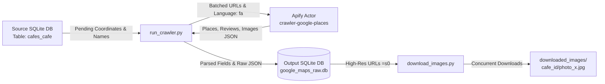

# Google Maps Cafe Data & Photo Scraper

A robust, fault-tolerant, and high-throughput data extraction pipeline designed to harvest complete raw metadata, rich reviews, and uncompressed, ultra-high-resolution photos of cafes and venues from Google Maps using Apify.

---

## Table of Contents
- [Key Features](#key-features)
- [Architecture & Workflow](#architecture--workflow)
- [Prerequisites & Installation](#prerequisites--installation)
- [Environment Configuration](#environment-configuration)
- [Usage Guide](#usage-guide)
  - [1. Scraping Data from Google Maps](#1-scraping-data-from-google-maps)
  - [2. Downloading High-Resolution Photos](#2-downloading-high-resolution-photos)
- [Technical Architecture](#technical-architecture)
  - [Geo-Targeted Coordinate Matching](#geo-targeted-coordinate-matching)
  - [Ultra High-Resolution Media Pipeline (`=s0`)](#ultra-high-resolution-media-pipeline-s0)
  - [Resumability & Fault Tolerance](#resumability--fault-tolerance)
  - [Zero Data Loss Storage](#zero-data-loss-storage)
- [Database Schema Reference](#database-schema-reference)
- [Directory Structure](#directory-structure)
- [Security & Best Practices](#security--best-practices)

---

## Key Features

- **Geo-Targeted Viewport Search:** Eliminates ambiguous match errors and cross-city collision by anchoring the Google Maps viewport radius to ~200-300m (`Zoom 17`) centered on exact geographic coordinates.
- **Zero Data Loss:** Preserves the entire unstructured JSON payload returned by Apify/Google in `raw_data` while simultaneously indexing structured columns (rating, reviews, phone, categories, address).
- **Camera-Original Resolution Media Engine (`=s0`):** Automatically detects Google server-side image scaling flags (`=w...-h...`) and transforms them into `=s0`, pulling original camera master files without compression.
- **Resumable & Fault-Tolerant:** Tracks crawler state directly within SQLite. In the event of network disruption or process termination, subsequent runs skip previously completed places and resume cleanly.
- **High-Throughput Parallel Downloader:** Multi-threaded asynchronous asset downloader with retry mechanisms and adaptive fallback handling.
- **Batched Execution:** Distributes search operations in batches to `compass/crawler-google-places` on Apify to optimize API memory allocation and run costs.
- **Zero Hardcoding & Portability:** Fully configurable paths, batch sizes, retry parameters, and concurrency limits via standard `.env` variables.

---

## Architecture & Workflow



---

## Prerequisites & Installation

### 1. Requirements
- Python 3.9 or higher
- An active [Apify Account](https://apify.com) with API access token

### 2. Environment Setup
Clone the repository and set up a virtual environment:

```bash
# Clone the repository
git clone https://github.com/osumy/apify_maps.git
cd apify_maps

# Create a virtual environment
python -m venv .venv

# Activate the virtual environment
# On Windows:
.venv\Scripts\activate
# On Linux / macOS:
source .venv/bin/activate

# Install required dependencies
pip install -r requirements.txt
```

---

## Environment Configuration

Copy the sample environment file `.env.example` to create your active `.env`:

```bash
cp .env.example .env
```

Open `.env` and provide your Apify API token along with any custom path overrides:

```env
# Apify API Token (Required)
# Retrieve from: https://console.apify.com/account/integrations
APIFY_TOKEN=apify_api_xxxxxxxxxxxxxxxxxxxx

# Source database containing input cafes with coordinates (table: cafes_cafe)
SOURCE_DB_PATH=c:\Users\amira\Desktop\crawler\cafes_cafe_shard00.db

# Output SQLite database file path
OUTPUT_DB_PATH=google_maps_raw.db

# Output directory for downloaded images
IMAGES_DIR=downloaded_images

# Concurrency level for image downloads
MAX_IMAGE_WORKERS=25

# Crawler batch size per Apify run
BATCH_SIZE=50

# Maximum photos to request per place
MAX_IMAGES_PER_PLACE=50

# Maximum reviews to request per place
MAX_REVIEWS_PER_PLACE=15

# Viewport zoom level
ZOOM_LEVEL=17
```

---

## Usage Guide

### 1. Scraping Data from Google Maps

To run the full crawler over all pending cafes from the source database:
```bash
python run_crawler.py
```

To run a limited test run (e.g., scrape the next 5 pending cafes):
```bash
python run_crawler.py 5
```

### 2. Downloading High-Resolution Photos

To download all scraped high-resolution photos for all successfully matched cafes:
```bash
python download_images.py
```

To download photos for a specific venue by its ID (e.g., cafe ID `32`):
```bash
python download_images.py 32
```

Photos are organized hierarchically:
```text
downloaded_images/
├── 32/
│   ├── photo_1.jpg
│   ├── photo_2.jpg
│   └── photo_3.jpg
└── 100/
    ├── photo_1.jpg
    └── photo_2.jpg
```

---

## Technical Architecture

### Geo-Targeted Coordinate Matching
Standard text queries often produce ambiguous results or match cafes with common names located hundreds of kilometers away. To guarantee deterministic matching, search queries are constructed with viewport coordinate locking:
```text
https://www.google.com/maps/search/{encoded_name}/@{lat},{lng},{zoom}z
```
At `Zoom 17`, Google Maps restricts its viewport to a narrow radius (~200–300 meters), pinning the search specifically to the target venue while filtering out distant namesakes.

### Ultra High-Resolution Media Pipeline (`=s0`)
Google Maps serves user-uploaded images via dynamic content delivery parameters (e.g., `=w1920-h1080-k-no`). The scraper parses image URLs and replaces any downsampling parameters with `=s0`:
- `=s0` instructs Google's image edge servers to serve the uncompressed, full-dimension original master image as uploaded by the photographer.
- If a rare server-side HTTP 400 error occurs on an unformatted asset, the downloader gracefully falls back to high-res `=w1600-h1200`.

### Resumability & Fault Tolerance
Each crawler run initializes the target database and builds an index of previously evaluated `cafe_id` entries (including both successful matches and verified `not_found` records). Unmatched cafes are logged to prevent redundant API queries. Any interrupted session resumes exactly where it left off.

### Zero Data Loss Storage
Rather than only capturing a predefined set of fields, the scraper archives the raw, unedited JSON dictionary from Apify in the `raw_data` column. If additional attributes (e.g., popular times, accessibility options, or amenities) are needed later, they can be extracted without re-crawling.

---

## Database Schema Reference

Table: `google_places_raw`

| Column | Type | Description |
| :--- | :--- | :--- |
| `cafe_id` | `INTEGER PRIMARY KEY` | Identifier from the input source database |
| `original_name` | `TEXT` | Input query name |
| `searched_lat` | `REAL` | Target latitude passed to viewport |
| `searched_lng` | `REAL` | Target longitude passed to viewport |
| `search_url` | `TEXT` | Viewport URL constructed for Apify query |
| `place_id` | `TEXT` | Canonical Google Place ID |
| `title` | `TEXT` | Verified business title on Google Maps |
| `category` | `TEXT` | Business primary category |
| `address` | `TEXT` | Full human-readable physical address |
| `phone` | `TEXT` | Contact phone number |
| `rating` | `REAL` | Average user rating (1.0 - 5.0) |
| `reviews_count` | `INTEGER` | Total number of user reviews |
| `images_count` | `INTEGER` | Total photos associated with the listing |
| `image_urls` | `TEXT` | JSON array of default photo URLs |
| `high_res_image_urls` | `TEXT` | JSON array of `=s0` uncompressed URLs |
| `scraped_reviews` | `TEXT` | JSON array of detailed reviews (text, score, date, author) |
| `raw_data` | `TEXT` | Complete unedited JSON payload from Apify |
| `status` | `TEXT` | Resolution status (`success` or `not_found`) |
| `scraped_at` | `TIMESTAMP` | Record insertion timestamp |

---

## Directory Structure

```text
apify_maps/
├── .env.example          # Sample environment and parameter definitions
├── .gitignore            # Git exclusion rules for secrets, virtualenvs, and data
├── requirements.txt      # Python dependencies
├── run_crawler.py        # Core scraping engine interacting with Apify
├── download_images.py    # Multi-threaded high-res image downloader
├── README.md             # Project documentation
└── google_maps_raw.db    # SQLite database containing scraped records
```

---

## Security & Best Practices

- **Never Commit Secrets:** The `.env` file containing your `APIFY_TOKEN` is ignored by `.gitignore`. Keep your tokens secure.
- **Bandwidth Consumption:** Downloading master resolution images (`=s0`) consumes significantly more bandwidth and disk space than thumbnails. Adjust `MAX_IMAGES_PER_PLACE` in `.env` if local storage or quota is constrained.
