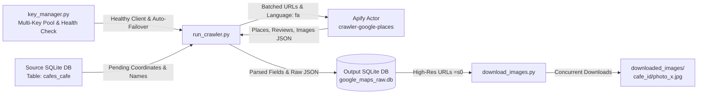

# Google Maps Cafe Data & Photo Scraper

A robust, fault-tolerant, and high-throughput data extraction pipeline designed to harvest complete raw metadata, rich reviews, and uncompressed, ultra-high-resolution photos of cafes and venues from Google Maps using Apify.

---

## Table of Contents
- [Key Features](#key-features)
- [Architecture & Workflow](#architecture--workflow)
- [Prerequisites & Installation](#prerequisites--installation)
- [Environment Configuration](#environment-configuration)
- [Usage Guide](#usage-guide)
  - [1. Scraping Data from Google Maps](#1-scraping-data-from-google-maps)
  - [2. Downloading High-Resolution Photos](#2-downloading-high-resolution-photos)
- [Technical Architecture](#technical-architecture)
  - [Geo-Targeted Coordinate Matching](#geo-targeted-coordinate-matching)
  - [Ultra High-Resolution Media Pipeline (`=s0`)](#ultra-high-resolution-media-pipeline-s0)
  - [Resumability & Fault Tolerance](#resumability--fault-tolerance)
  - [Zero Data Loss Storage](#zero-data-loss-storage)
- [Database Schema Reference](#database-schema-reference)
- [Directory Structure](#directory-structure)
- [Security & Best Practices](#security--best-practices)

---

## Key Features

- **Multi-Key Token Pool & Auto-Rotation:** Manages multiple Apify accounts simultaneously, monitoring remaining USD credits and monthly usage in real time. Transparently switches to the next healthy account whenever a key's quota or credit limit is exhausted.
- **Live Account Balance & Health Endpoint Inspection:** Built-in CLI and Python interface querying Apify's `/v2/users/me` and `/v2/users/me/limits` to display active balances, limits, and tiers.
- **Geo-Targeted Viewport Search:** Eliminates ambiguous match errors and cross-city collision by anchoring the Google Maps viewport radius to ~200-300m (`Zoom 17`) centered on exact geographic coordinates.
- **Zero Data Loss:** Preserves the entire unstructured JSON payload returned by Apify/Google in `raw_data` while simultaneously indexing structured columns (rating, reviews, phone, categories, address).
- **Camera-Original Resolution Media Engine (`=s0`):** Automatically detects Google server-side image scaling flags (`=w...-h...`) and transforms them into `=s0`, pulling original camera master files without compression.
- **Resumable & Fault-Tolerant:** Tracks crawler state directly within SQLite. In the event of network disruption or process termination, subsequent runs skip previously completed places and resume cleanly.
- **High-Throughput Parallel Downloader:** Multi-threaded asynchronous asset downloader with retry mechanisms and adaptive fallback handling.
- **Batched Execution:** Distributes search operations in batches to `compass/crawler-google-places` on Apify to optimize API memory allocation and run costs.
- **Zero Hardcoding & Portability:** Fully configurable paths, batch sizes, retry parameters, and concurrency limits via standard `.env` variables.

---

## Architecture & Workflow



---

## Prerequisites & Installation

### 1. Requirements
- Python 3.9 or higher
- An active [Apify Account](https://apify.com) with API access token

### 2. Environment Setup
Clone the repository and set up a virtual environment:

```bash
# Clone the repository
git clone https://github.com/osumy/apify_maps.git
cd apify_maps

# Create a virtual environment
python -m venv .venv

# Activate the virtual environment
# On Windows:
.venv\Scripts\activate
# On Linux / macOS:
source .venv/bin/activate

# Install required dependencies
pip install -r requirements.txt
```

---

## Environment Configuration

Copy the sample environment file `.env.example` to create your active `.env`:

```bash
cp .env.example .env
```

Open `.env` and provide your Apify API token along with any custom path overrides:

```env
# Apify API Token (Required)
# Retrieve from: https://console.apify.com/account/integrations
APIFY_TOKEN=apify_api_xxxxxxxxxxxxxxxxxxxx

# Source database containing input cafes with coordinates (table: cafes_cafe)
SOURCE_DB_PATH=c:\Users\amira\Desktop\crawler\cafes_cafe_shard00.db

# Output SQLite database file path
OUTPUT_DB_PATH=google_maps_raw.db

# Output directory for downloaded images
IMAGES_DIR=downloaded_images

# Concurrency level for image downloads
MAX_IMAGE_WORKERS=25

# Crawler batch size per Apify run
BATCH_SIZE=50

# Maximum photos to request per place
MAX_IMAGES_PER_PLACE=50

# Maximum reviews to request per place
MAX_REVIEWS_PER_PLACE=15

# Viewport zoom level
ZOOM_LEVEL=17
```

---

## Usage Guide

### 1. Scraping Data from Google Maps

To run the full crawler over all pending cafes from the source database:
```bash
python run_crawler.py
```

To run a limited test run (e.g., scrape the next 5 pending cafes):
```bash
python run_crawler.py 5
```

### 2. Downloading High-Resolution Photos

To download all scraped high-resolution photos for all successfully matched cafes:
```bash
python download_images.py
```

### 3. Inspecting Apify Account Balances & Key Health

The repository includes a dedicated CLI balance and pool manager (`key_manager.py`) that queries Apify's official `/v2/users/me` and `/v2/users/me/limits` endpoints:

To display an ASCII dashboard of all keys, user identities, monthly limits, current usage, and remaining USD:
```bash
python key_manager.py
```

Sample output:
```text
================================================================================================
                        APIFY MULTI-KEY POOL STATUS & BALANCES
================================================================================================
#   | Token                  | User / Email                 | Tier   | Limit   | Used    | Rem.    | Status
------------------------------------------------------------------------------------------------
1   | apify_api_eJGiV...2wP8tx | pronounced_zaibatsu (amira.. | FREE   | $10.00  | $6.95   | $3.05   | 🟢 ACTIVE
2   | apify_api_o0Y2k...3NBzco | AliThz-Pro (alithz.pro@gmai) | FREE   | $5.00   | $0.00   | $5.00   | 🟢 ACTIVE
3   | apify_api_SOuyK...4eozU9 | Unknown                      | UNKNOWN | -       | -       | -       | 🔴 INVALID
4   | apify_api_HLftj...24K5oM | fair_laureate (ali.thz83@g.. | FREE   | $5.00   | $0.00   | $5.00   | 🟢 ACTIVE
------------------------------------------------------------------------------------------------
Summary: Total Keys: 4 | Active: 3 | Exhausted: 0 | Invalid: 1
Total Usable Balance: $13.05 USD
Current Working Key: apify_api_eJGiV...2wP8tx (User: pronounced_zaibatsu, Rem: $3.05)
================================================================================================
```

To export the pool status in JSON format:
```bash
python key_manager.py --json
```

To run unit tests verifying key failover, error detection, and rotation:
```bash
python -m unittest test_key_manager.py
```

To download photos for a specific venue by its ID (e.g., cafe ID `32`):
```bash
python download_images.py 32
```

Photos are organized hierarchically:
```text
downloaded_images/
├── 32/
│   ├── photo_1.jpg
│   ├── photo_2.jpg
│   └── photo_3.jpg
└── 100/
    ├── photo_1.jpg
    └── photo_2.jpg
```

---

## Technical Architecture

### Geo-Targeted Coordinate Matching
Standard text queries often produce ambiguous results or match cafes with common names located hundreds of kilometers away. To guarantee deterministic matching, search queries are constructed with viewport coordinate locking:
```text
https://www.google.com/maps/search/{encoded_name}/@{lat},{lng},{zoom}z
```
At `Zoom 17`, Google Maps restricts its viewport to a narrow radius (~200–300 meters), pinning the search specifically to the target venue while filtering out distant namesakes.

### Ultra High-Resolution Media Pipeline (`=s0`)
Google Maps serves user-uploaded images via dynamic content delivery parameters (e.g., `=w1920-h1080-k-no`). The scraper parses image URLs and replaces any downsampling parameters with `=s0`:
- `=s0` instructs Google's image edge servers to serve the uncompressed, full-dimension original master image as uploaded by the photographer.
- If a rare server-side HTTP 400 error occurs on an unformatted asset, the downloader gracefully falls back to high-res `=w1600-h1200`.

### Resumability & Fault Tolerance
Each crawler run initializes the target database and builds an index of previously evaluated `cafe_id` entries (including both successful matches and verified `not_found` records). Unmatched cafes are logged to prevent redundant API queries. Any interrupted session resumes exactly where it left off.

### Zero Data Loss Dual-Storage Architecture
The system decouples raw extraction from analytical querying:
1. **Raw Storage (`google_maps_raw.jsonl`):** Each raw JSON payload returned by Apify is preserved 100% intact as append-only JSON Lines. If Google changes or adds fields in the future, zero data is lost.
2. **Clean Relational DB (`google_maps.db`):** Highly normalized SQLite tables without redundant text dumps, indexed for fast querying, filtering, and joining.

---

## Database Schema Reference

The relational database (`google_maps.db`) consists of dedicated, indexed tables:

### 1. Table: `places` (Core Venue Profile)
| Column | Type | Description |
| :--- | :--- | :--- |
| `cafe_id` | `INTEGER PRIMARY KEY` | Source database cafe identifier |
| `place_id` | `TEXT UNIQUE` | Canonical Google Place ID (`ChIJ...`) |
| `cid` | `TEXT` | Google Maps customer ID |
| `title` | `TEXT` | Verified business name on Google Maps |
| `original_name` | `TEXT` | Source query name |
| `name_match_score` | `REAL` | Name similarity score (0.0 - 1.0) for mismatch detection |
| `category_name` | `TEXT` | Primary category (e.g. کافی شاپ) |
| `address` | `TEXT` | Full physical address |
| `city` / `state` | `TEXT` | City and province/state |
| `latitude` / `longitude` | `REAL` | Coordinates scraped from Google |
| `phone` | `TEXT` | Contact phone number |
| `website` | `TEXT` | Business website or Instagram link |
| `total_score` | `REAL` | Average rating (1.0 - 5.0) |
| `reviews_count` | `INTEGER` | Total Google Maps reviews count |
| `images_count` | `INTEGER` | Total Google Maps photos count |
| `is_claimed` | `BOOLEAN` | Whether claimed via Google Business Profile |
| `status` | `TEXT` | Resolution status (`success` or `not_found`) |

### 2. Table: `place_images` (Unified Media Gallery)
| Column | Type | Description |
| :--- | :--- | :--- |
| `id` | `INTEGER PRIMARY KEY` | Auto-incrementing photo ID |
| `cafe_id` | `INTEGER` | Foreign key to `places.cafe_id` |
| `source_type` | `TEXT` | Photo source: `'cover'`, `'gallery'`, or `'review'` |
| `is_owner_photo` | `BOOLEAN` | `1` if official cover or owner upload; `0` for visitor photos |
| `author_name` | `TEXT` | Uploading author name |
| `review_id` | `TEXT` | Foreign key to `place_reviews.review_id` (if from review) |
| `image_url` | `TEXT` | Original Google image URL |
| `high_res_url` | `TEXT` | Uncompressed camera master URL (`=s0`) |
| `local_path` | `TEXT` | Path on local disk once downloaded |
| `download_status`| `TEXT` | Status: `'pending'`, `'downloaded'`, `'failed'` |

### 3. Table: `place_reviews` (Rich Customer Feedback)
| Column | Type | Description |
| :--- | :--- | :--- |
| `review_id` | `TEXT PRIMARY KEY` | Google review ID (`Ci9DQUl...`) |
| `cafe_id` | `INTEGER` | Foreign key to `places.cafe_id` |
| `reviewer_name` | `TEXT` | Name of the reviewer |
| `stars` | `INTEGER` | Rating given (1 to 5) |
| `publish_date` | `TEXT` | ISO 8601 UTC timestamp |
| `text` | `TEXT` | Review text |
| `likes_count` | `INTEGER` | Helpful votes on the review |
| `is_local_guide` | `BOOLEAN` | True if author is a Google Local Guide |
| `detailed_food_rating` | `REAL` | Sub-rating for food quality |
| `detailed_service_rating` | `REAL` | Sub-rating for service |
| `detailed_atmosphere_rating` | `REAL` | Sub-rating for atmosphere |

### 4. Table: `place_attributes` (Amenities & Features)
Extracted from Google Maps `additionalInfo`:
* `cafe_id`, `group_name` (e.g. `'امکانات'`, `'محیط'`, `'پارکینگ'`), `attribute_name` (e.g. `'فضای باز'`, `'قهوه عالی'`, `'وای‌فای'`).

### 5. Tables: `place_opening_hours` & `place_popular_times`
* `place_opening_hours`: Weekly schedule per day.
* `place_popular_times`: Hourly foot traffic histogram per day of week.

---

## Directory Structure

```text
apify_maps/
├── .env.example              # Sample environment configuration
├── .gitignore                # Git exclusion rules
├── requirements.txt          # Python dependencies
├── key_manager.py            # Multi-key pool & health inspector
├── test_key_manager.py       # Unit test suite for key manager
├── run_crawler.py            # Scraping engine with Dual-Storage & author extraction
├── download_images.py        # Multi-threaded high-res downloader with owner filter
├── migrate_to_relational.py  # Zero-loss migration script from legacy raw DB
├── benchmark_webp.py         # Image resolution & WebP format benchmark
├── README.md                 # Complete documentation
├── google_maps.db            # Clean, normalized relational database
└── google_maps_raw.jsonl     # Complete raw JSON Lines archive (zero data loss)
```

---

## Security & Best Practices

- **Never Commit Secrets:** The `.env` file containing your `APIFY_TOKEN` is ignored by `.gitignore`. Keep your tokens secure.
- **Bandwidth Consumption:** Downloading master resolution images (`=s0`) consumes significantly more bandwidth and disk space than thumbnails. Adjust `MAX_IMAGES_PER_PLACE` in `.env` if local storage or quota is constrained.
