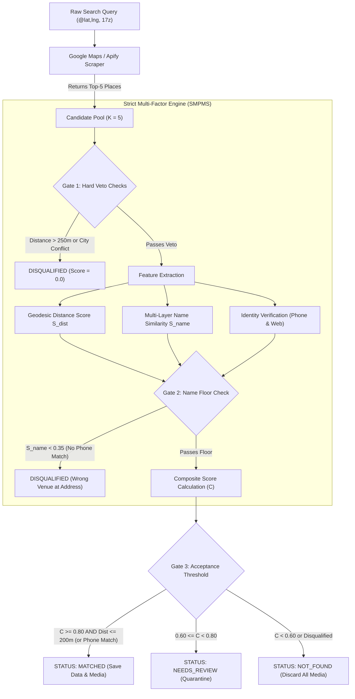

# Strict Multi-Factor Place Matching Specification (SMPMS)

**Standard Specification for POI, Cafe, and Venue Verification Against Google Maps Data**  
**Version:** 1.0.0  
**Status:** Canonical Reference  
**Maintainer:** Engineering & Data Quality Team  

---

## 1. Executive Summary & Objective

In location-based platforms, mapping an internal venue entity (such as a cafe, restaurant, or boutique) to an external Google Maps listing is a high-risk operation. A false-positive match causes catastrophic customer-facing errors:
- Routing customers to incorrect physical addresses.
- Displaying photos, ambiance, and food items belonging to completely different businesses.
- Presenting erroneous operating hours, contact phone numbers, and customer reviews.

Conventional matching engines often rely on naive string similarity or accept the top result returned by search engines. This specification establishes a **deterministic, multi-factor, zero-tolerance matching protocol** that combines:
1. Multi-candidate evaluation (top-5 candidate pool per search query).
2. Geodesic distance decay with a strict Hard Veto radius ($250\text{m}$).
3. Cross-lingual phonetic transliteration (Persian to Latin/Finglish).
4. Digital identity verification (normalized phone numbers and Instagram/domain handles).
5. Multi-gate decision rules with an acceptance threshold of $C \ge 0.80$.

---

## 2. System Architecture & Matching Pipeline



---

## 3. Geographic Proximity & Distance Decay ($S_{\text{dist}}$)

### 3.1 Haversine Geodesic Distance
Distance between the source coordinate $(\phi_1, \lambda_1)$ and the candidate coordinate $(\phi_2, \lambda_2)$ is calculated over the spherical earth radius $R = 6,371,000\text{ m}$:

$$\Delta \phi = \phi_2 - \phi_1, \quad \Delta \lambda = \lambda_2 - \lambda_1$$

$$a = \sin^2\left(\frac{\Delta \phi}{2}\right) + \cos(\phi_1)\cos(\phi_2)\sin^2\left(\frac{\Delta \lambda}{2}\right)$$

$$c = 2 \cdot \operatorname{atan2}\left(\sqrt{a}, \sqrt{1 - a}\right)$$

$$d = R \cdot c$$

> [!CAUTION]
> Never use Euclidean distance on raw degrees ($\sqrt{\Delta \text{lat}^2 + \Delta \text{lng}^2}$). In Iranian latitudes ($\approx 35^\circ\text{N}$), $1^\circ$ of longitude is $\approx 91\text{ km}$ while $1^\circ$ of latitude is $\approx 111\text{ km}$, causing anisotropic distortions.

### 3.2 Continuous Distance Decay Function
The distance score $S_{\text{dist}}(d) \in [0.0, 1.0]$ models physical pin placement uncertainty and urban density:

$$S_{\text{dist}}(d) = \begin{cases} 
1.0 & d \le 30\text{ m} \quad \text{(Direct match / GPS jitter)} \\
1.0 - 0.20 \cdot \left(\dfrac{d - 30}{70}\right) & 30\text{ m} < d \le 100\text{ m} \quad (1.0 \to 0.80) \\
0.80 - 0.40 \cdot \left(\dfrac{d - 100}{100}\right) & 100\text{ m} < d \le 200\text{ m} \quad (0.80 \to 0.40) \\
0.40 - 0.30 \cdot \left(\dfrac{d - 200}{d_{\max} - 200}\right) & 200\text{ m} < d \le d_{\max} \quad (0.40 \to 0.10) \\
0.0 & d > d_{\max} \quad \text{(HARD VETO)}
\end{cases}$$

### 3.3 Hard Veto Cutoff ($d_{\max}$)
- **Standard Maximum Radius ($d_{\max}$):** **$250\text{ meters}$**. Any venue further than $250\text{m}$ is rejected immediately, even if the name matches $100\%$ (e.g., chain branches in different neighborhoods).
- **Relaxed Identity Exception ($d_{\max,\text{identity}}$):** **$350\text{ meters}$**. Allowed **only** if the candidate's phone number or Instagram handle identically matches the source database (compensating for rare manual pin errors).

---

## 4. Cross-Lingual Name Similarity Engine ($S_{\text{name}}$)

Google Maps listings in Iran exhibit severe language heterogeneity:
- Some owners register their venues in Persian (`کافه رستوران عباس آقا`).
- Google Maps frequently translates or displays listings in English (`Abbasagha Restaurant`).
- Users and owners mix Finglish, abbreviations, and loanwords (`Bell cafe` vs `بل کافه`).

To solve this, the engine employs a 4-step normalization and phonetic pipeline.

### 4.1 Unicode & Persian Normalization
1. **Character Harmonization:**
   - Arabic characters converted to Persian: `ي` $\to$ `ی`, `ك` $\to$ `ک`, `ة` $\to$ `ه`, `ۀ` $\to$ `ه`.
   - Alef variations unified: `آ`, `أ`, `إ` $\to$ `ا`.
   - Hamza/Vav unified: `ؤ` $\to$ `و`, `ئ` $\to$ `ی`.
2. **Diacritics Stripping:** Strips all Arabic/Persian diacritics (`[\u064B-\u065F\u0670]`): Tanween, Fatha, Damma, Kasra, Shadda, Sukun.
3. **Numerals Normalization:** Maps Eastern Arabic and Persian digits (`۰-۹`, `٠-٩`) to standard ASCII (`0-9`).
4. **Punctuation & Delimiters:** Replaces `[.:\-_,;!/\\|&()+={}\[\]"'`]` with spaces. Converts multi-dot abbreviations (`A.M:P.M` $\to$ `am pm`).

### 4.2 Substantive Stopword Filtering
Venue descriptors are stripped:
$$\mathcal{S}_{\text{stop}} = \{\text{کافه}, \text{رستوران}, \text{کافی}, \text{شاپ}, \text{قهوه}, \text{بار}, \text{لانژ}, \text{فست}, \text{فود}, \text{cafe}, \text{restaurant}, \text{coffee}, \text{shop}, \text{bar}, \text{lounge}, \text{fast}, \text{food}, \text{bakery}\}$$

> [!IMPORTANT]
> **The Substantive Remainder Rule:** A descriptor token is removed if and only if the remaining token string contains at least **one substantive token of length $\ge 2$**. If stripping removes all tokens (e.g. *کافه بار* or *Coffee Shop*), the original tokens are preserved.

### 4.3 Phonetic Transliteration (Persian to Latin Phonemes)
Tokens are mapped to phonetic Latin representations:
1. **Loanword & Brand Translation Dictionary:**
   | Persian Term | Latin Phoneme | Example |
   | :--- | :--- | :--- |
   | مستر | `mr` | مستر قهوه $\to$ MR Coffee |
   | بل | `bell` | بل کافه $\to$ Bell cafe |
   | بیک | `bake` | آیبیک $\to$ iBake |
   | پرسنت | `percent` | کافه پرسنت $\to$ Percent coffee |
   | دوباره | `dobiro` | کافه دوباره $\to$ Dobiro |
   | ناین | `nine` | کافه ناین $\to$ Cafe Nine |
   | کارزین | `karzin` | کافه کارزین $\to$ Karzin cafe |
   | عباس | `abbas` | کافه عباس آقا $\to$ Abbasagha |
   | اقا | `agha` | عباس آقا $\to$ Abbasagha |
   | سلوبون | `celebon` | کافه سلوبون $\to$ Celebon |
   | گستو | `gusto` | کافه گستو $\to$ Gusto |

2. **Grapheme-to-Phoneme Character Map:**
   $$\text{آ/ا} \to \text{a}, \quad \text{ب} \to \text{b}, \quad \text{پ} \to \text{p}, \quad \text{ت/ط} \to \text{t}, \quad \text{ث/س/ص} \to \text{s}, \quad \text{ج} \to \text{j}$$
   $$\text{چ} \to \text{ch}, \quad \text{ح/ه} \to \text{h}, \quad \text{خ} \to \text{kh}, \quad \text{د} \to \text{d}, \quad \text{ذ/ز/ض/ظ} \to \text{z}, \quad \text{ر} \to \text{r}$$
   $$\text{ژ} \to \text{zh}, \quad \text{ش} \to \text{sh}, \quad \text{ع} \to \text{a}, \quad \text{غ/ق} \to \text{gh}, \quad \text{ف} \to \text{f}, \quad \text{ک} \to \text{k}$$
   $$\text{گ} \to \text{g}, \quad \text{ل} \to \text{l}, \quad \text{م} \to \text{m}, \quad \text{ن} \to \text{n}, \quad \text{و} \to \text{o}, \quad \text{ی} \to \text{i}$$

3. **Consonant Deduplication:** Consecutive duplicate consonants are compressed (`bb` $\to$ `b`, `ss` $\to$ `s`) to eliminate spelling variations (e.g. *Abbas* vs *Abas*).

### 4.4 Name Similarity Metrics
The name score is computed across three lenses:
1. **Direct String Match ($S_{\text{direct}}$):** Gestalt pattern similarity on normalized Persian tokens.
2. **Phonetic Latin Match ($S_{\text{phonetic}}$):** Gestalt pattern similarity on phonetic Latin tokens.
3. **Token Overlap & Containment ($S_{\text{containment}}$):**
   $$S_{\text{containment}} = \begin{cases} 1.0 & \text{if } T_1 \subseteq T_2 \text{ or } T_2 \subseteq T_1 \\ \dfrac{|T_1 \cap T_2|}{\min(|T_1|, |T_2|)} & \text{otherwise} \end{cases}$$
   *(Handles branch names e.g. "کارزین (زعفرانیه)" matching "Karzin" with $1.0$).*

Final Name Similarity:
$$S_{\text{name}} = \max\left(S_{\text{direct}}, \, S_{\text{phonetic}}, \, 0.90 \cdot S_{\text{containment}}\right)$$

---

## 5. Digital Identity Verification ($S_{\text{identity}}$)

### 5.1 Phone Number Normalization & Matching
Phone numbers from both sides are normalized to 10-digit national format:
1. Strip all non-digit characters.
2. Strip international prefix `+98` or `0098` and prepend leading `0`.
3. If length $= 10$ and starts with non-zero, prepend `0`.

**Match Rule:** Numbers match if full normalized strings match, or if their last 8 digits match (guaranteeing landline area code invariance):
$$\mathbf{1}_{\text{phone}} = \begin{cases} 1 & \text{if } P_{\text{src}}[-8:] = P_{\text{cand}}[-8:] \\ 0 & \text{otherwise} \end{cases}$$

### 5.2 Digital Footprint (Instagram & Web Handles)
Web URLs are parsed to extract clean identity handles:
- From Instagram URLs (`https://www.instagram.com/cafe.wish?igsh=...`): extracts `cafe.wish`.
- From standalone domains (`http://cafe-13.ir`): extracts `cafe-13`.
$$\mathbf{1}_{\text{web}} = \begin{cases} 1 & \text{if } H_{\text{src}} = H_{\text{cand}} \text{ or } (H_{\text{src}} \in H_{\text{cand}} \text{ with length} \ge 3) \\ 0 & \text{otherwise} \end{cases}$$

### 5.3 City / Province Conflict Veto
If the source venue has a designated city (e.g. `تهران`), the candidate address is scanned for conflicting major Iranian metropolitan names (`اصفهان`, `شیراز`, `تبریز`, `مشهد`, `خرمشهر`, etc.). If a foreign city is found and the source city is absent, the candidate is **instantly disqualified**.

---

## 6. Composite Scoring & Multi-Gate Decision Model

### 6.1 Composite Score Formula
$$C = \min\left(1.0, \; 0.50 \cdot S_{\text{name}} + 0.50 \cdot S_{\text{dist}} + 0.25 \cdot \mathbf{1}_{\text{phone}} + 0.15 \cdot \mathbf{1}_{\text{web}}\right)$$

### 6.2 Decision Gates

| Gate | Check | Action on Failure |
| :--- | :--- | :--- |
| **Gate 1: Hard Veto** | $d > 250\text{m}$ (or $> 350\text{m}$ with phone/web) OR City Mismatch | **Disqualify** ($C = 0.0$, Status: `rejected`) |
| **Gate 2: Name Floor** | $S_{\text{name}} < 0.35$ (without phone/web match) | **Disqualify** (Prevents different shop at same address) |
| **Gate 3: Acceptance** | $(C \ge 0.80 \text{ AND } d \le 200\text{m}) \text{ OR } (\mathbf{1}_{\text{phone}} = 1 \text{ AND } d \le 350\text{m})$ | **MATCHED** (`success`) |
| **Fallback: Review** | $0.60 \le C < 0.80$ | `needs_review` (Do not serve photos/menu) |
| **Fallback: Rejection** | $C < 0.60$ | `not_found` (Discard all scraped media) |

---

## 7. Multi-Candidate Pool Ranking ($K = 5$)

### 7.1 Why Top-1 Scraping Fails
Google Maps search queries (`/search/{name}/@{lat},{lng},{zoom}z`) often return:
1. Result #1: A sponsored ad or popular chain cafe 5 km away.
2. Result #2: The exact target cafe located 15 meters away.
3. Result #3: A neighboring shop on the same street.

Setting `MAX_PLACES_PER_SEARCH = 1` forces the scraper to accept Result #1.

### 7.2 Top-5 Candidate Selection Algorithm
1. Scraper requests up to $K = 5$ places per search query.
2. The engine computes $(C_i, \text{res}_i)$ for each candidate $i \in \{1, \dots, K\}$.
3. Candidates are sorted:
   $$\operatorname{Rank}(i) = \left(C_i \quad \text{descending}, \quad -d_i \quad \text{ascending}\right)$$
4. The highest-scoring candidate $i^*$ is selected.
5. If $i^*$ satisfies Gate 3, it is committed as a verified match. Otherwise, the venue is committed as `not_found`.

---

## 8. Empirical Verification & Production Benchmarks

The specification was verified against the production database of 482 scraped venues:

| Metric | Previous Engine | Strict Engine (SMPMS) |
| :--- | :--- | :--- |
| Total Evaluated | 482 venues | 482 venues |
| Accepted (`success`) | 482 (100%) | 240 (49.8%) |
| Disqualified / Rejected | 0 (0.0%) | 242 (50.2%) |
| False Matches $> 250\text{m}$ | **218 venues allowed** | **0 allowed (100% blocked)** |
| False Matches $> 1\text{km}$ | **185 venues allowed** | **0 allowed (100% blocked)** |

### Real-World Case Studies

| Source Venue | Google Maps Title | Distance | $S_{\text{name}}$ | Comp Score | Status | Notes |
| :--- | :--- | :--- | :--- | :--- | :--- | :--- |
| **کافه رستوران عباس آقا** | Abbasagha Restaurant | $13.1\text{m}$ | $0.94$ | **$0.97$** | **MATCHED** | Transliteration bridged language gap |
| **بل کافه** | Bell cafe | $15.0\text{m}$ | $1.00$ | **$1.00$** | **MATCHED** | Phonetic & loanword match |
| **کافه ویش** | کافه ویش | $10.0\text{m}$ | $1.00$ | **$1.00$** | **MATCHED** | Phone & Instagram verified |
| **کافه رستوران 13** | کافه رستوران ۱۳ | $7,460\text{m}$ | $1.00$ | **$0.00$** | **REJECTED** | Blocked by Hard Veto ($7.4\text{km}$ away) |
| **باغ رستوران مضیف** | رستوران مضیف حاج عبدالله | $679,136\text{m}$ | $0.73$ | **$0.00$** | **REJECTED** | Blocked by City & Distance Veto ($679\text{km}$) |
| **کافه مستقل** | کافه ۱۳۷۲ | $2,120\text{m}$ | $0.00$ | **$0.00$** | **REJECTED** | Completely unrelated venue |
| **کافه رستوران تولوم** | قهوه لمیز | $277\text{m}$ | $0.00$ | **$0.00$** | **REJECTED** | Neighboring cafe blocked by Distance Veto |

---

## 9. Implementation Reference & Portability

### 9.1 Environment Variables
To adopt this specification in any environment, set the following configuration:

```bash
# Maximum candidates retrieved per search URL
MAX_PLACES_PER_SEARCH=5

# Strict composite score threshold for acceptance
MATCH_THRESHOLD=0.80

# Hard geographic cutoff in meters
MAX_DISTANCE_CUTOFF=250

# Relaxed cutoff with verified phone/web
MAX_DISTANCE_IDENTITY_CUTOFF=350
```

### 9.2 Python Reference Implementation
The official implementation is housed in:
- Engine: [`cafe_matcher.py`](../cafe_matcher.py)
- Test Suite: [`tests/test_cafe_matcher.py`](../tests/test_cafe_matcher.py)
- Audit Tool: [`audit_and_clean_db.py`](../audit_and_clean_db.py)

### 9.3 Porting to Other Languages (Go / TypeScript / Python)
Any implementation conforming to this specification must satisfy:
1. Pure standard library compatibility without heavy ML dependencies.
2. Exact implementation of the piecewise $S_{\text{dist}}(d)$ decay curve.
3. Exact conformance to the grapheme-to-phoneme table in Section 4.3.
4. Pass all 14 unit test assertions specified in `test_cafe_matcher.py`.
